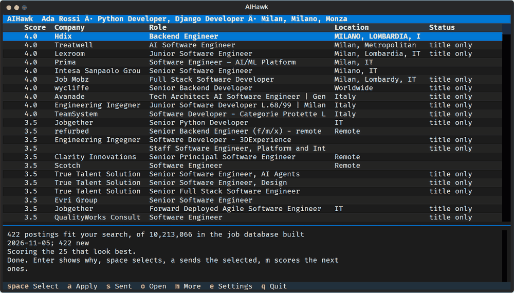

<div align="center">

<picture>
  <source media="(prefers-color-scheme: dark)" srcset="assets/logo-dark.png">
  
</picture>

**Your resume in. From 10 million postings, the jobs that fit. Select them, press one key, and watch a real browser apply.**

<sub>THE EARLIER AIHAWK WAS FEATURED IN</sub><br>
[**Business Insider**](https://www.businessinsider.com/aihawk-applies-jobs-for-you-linkedin-risks-inaccuracies-mistakes-2024-11) ·
[**TechCrunch**](https://techcrunch.com/2024/10/10/a-reporter-used-ai-to-apply-to-2843-jobs/) ·
[**Semafor**](https://www.semafor.com/article/09/12/2024/linkedins-have-nots-and-have-bots) ·
[**Wired**](https://www.wired.it/article/aihawk-come-automatizzare-ricerca-lavoro/) ·
[**The Verge**](https://www.theverge.com/2024/10/10/24266898/ai-is-enabling-job-seekers-to-think-like-spammers) ·
[**Vanity Fair**](https://www.vanityfair.it/article/intelligenza-artificiale-candidature-di-lavoro) ·
[**404 Media**](https://www.404media.co/i-applied-to-2-843-roles-the-rise-of-ai-powered-job-application-bots/)

</div>

---

Windows, in PowerShell:

```powershell
irm https://raw.githubusercontent.com/feder-cr/Jobs_Applier_AI_Agent/main/run.ps1 | iex
```

Linux:

```bash
curl -LsSf https://raw.githubusercontent.com/feder-cr/Jobs_Applier_AI_Agent/main/run.sh | sh
```

That is the only command, now and every time after: it installs what is missing, updates AIHawk and starts it. Everything else is on the screen.



## What it does

1. **Reads your resume** and writes a search plan from it. You can change it on the screen.
2. **Narrows down the jobs.** About 10.2 million postings from 24 public sources, rebuilt daily. 600 by their titles, on your computer. 100 read by [Jev](https://github.com/feder-cr/jev), a decision model. 25 scored from 1 to 5, with the gaps and the reasons.
3. **Applies.** You select the jobs and say yes once. For each one it fills the form and attaches your CV, in a browser you can watch, through [invisible-playwright-mcp](https://github.com/feder-cr/invisible_playwright_mcp), sends it, and keeps what the page said.

## Where it applies

| | |
|---|---|
| **Sent and confirmed by the page** | Greenhouse, Ashby, Breezy, Recruitee, Teamtailor |
| **Forms filled, send not confirmed yet** | Lever, SmartRecruiters, Workable, Paylocity |
| **Often stopped by a captcha** | JazzHR, BambooHR, Personio |
| **By hand, for now** | Workday, iCIMS and the rest: they need an account |

One send each so far, so "it can send", not "it sends reliably": [what has really been seen](docs/sites.md). A site is one Markdown file that explains its pages to the model, with no code: [add yours](docs/plugins.md).

## Before you send

- **It goes out in your name, unread, after one yes.** The model takes what your CV says and works out what it implies. Where it has nothing, it writes "Please see my attached CV", picks the closest option and ticks the boxes the form requires, statements such as the right to work included. You answer for all of it. Sites have terms of their own, and some do not allow this.
- **Nothing checks what the model does in the browser.** It is told to leave the send to AIHawk, and it could send early or half filled: [SECURITY.md](SECURITY.md).
- **Your CV, the postings and the pages, screenshots included, go to [OrcaRouter](https://orcarouter.ai) and its providers**, on your paid key. A form cost 0.4 to 3.3 cents in our runs. The rest stays in `~/.aihawk`, sign-ins included.
- **The first run downloads about 740 MB** of job index, and the first form about 268 MB of browser. Windows and Linux: the browser has no macOS build.
- **The job data is not ours.** Each posting belongs to its employer. Some sources state no licence, and one asks not to be republished as listings; the published database includes it. [Every source](docs/data-sources.md).

---

[Configuration](docs/configuration.md) · [Wiki](https://github.com/feder-cr/Jobs_Applier_AI_Agent/wiki) · [Contributing](CONTRIBUTING.md) · [Changelog](CHANGELOG.md) · [Notice](NOTICE) · [MIT](LICENSE)

The former Dots project is at [feder-cr/invisible_dots](https://github.com/feder-cr/invisible_dots).
